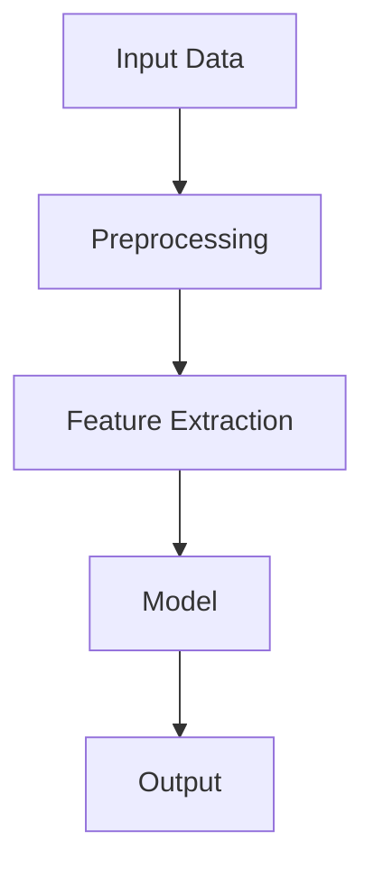
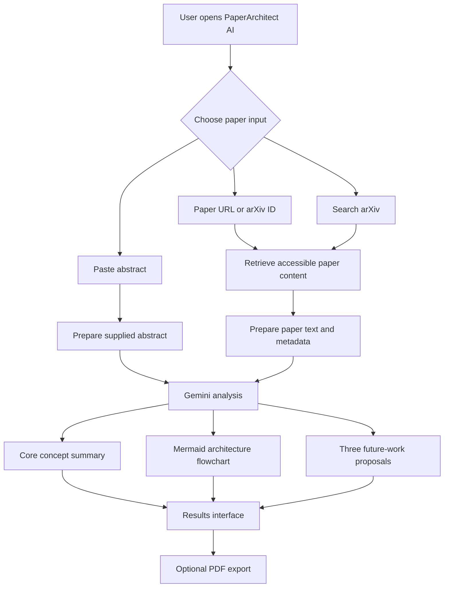

# CS Research Agent: Paper Parser & Architecture Architect

**CS Research Agent** is an AI-powered academic paper analysis application developed in **Google AI Studio**. Its frontend uses **React, TypeScript, and Vite**, with Gemini-powered analysis. It helps students and early-stage researchers understand academic papers, inspect their system architectures, and identify realistic project extensions that can strengthen a technical portfolio.

The application is designed to turn a research paper into a practical starting point for implementation: a concise explanation, an architecture flowchart, and measurable ideas for future work.

> **Project status:** This README describes the CS Research Agent application shown in the project preview. Confirm the exact model ID, framework, package versions, and enabled APIs against your Google AI Studio project before publishing.

## Table of Contents

- [Problem](#problem)
- [Solution](#solution)
- [Features](#features)
- [How to Use](#how-to-use)
- [Analysis Output](#analysis-output)
- [Application Workflow](#application-workflow)
- [Technology](#technology)
- [Architecture](#architecture)
- [Run Locally](#run-locally)
- [Configuration and API Safety](#configuration-and-api-safety)
- [Evaluation](#evaluation)
- [Limitations](#limitations)
- [Future Improvements](#future-improvements)
- [Acknowledgements](#acknowledgements)
- [License](#license)

## Problem

Reading research papers can be difficult for students who are new to a research area. Papers often contain unfamiliar terminology, complex mathematical explanations, and system architectures that are not immediately easy to translate into an implementation plan.

Students may also struggle to identify:

- The actual problem a paper is solving.
- The main methodology and important algorithmic ideas.
- How data moves through the proposed system.
- What limitations remain open for further research.
- Which extensions are achievable with student-level time and resources.
- Which tools and performance metrics would be appropriate for an extension.

## Solution

CS Research Agent provides a guided research-paper analysis workflow. A user supplies a paper through a supported input method, and the application uses Google's Gemini model to help produce a structured explanation and implementation-oriented analysis.

The goal is not to replace reading the original paper. It is to help users understand it faster, inspect its architecture, and develop informed ideas for their own experiments and projects.

## Features

### Research paper input

The interface provides three ways to start an analysis:

- **Paper URL / arXiv:** Enter a paper link or arXiv identifier.
- **Search arXiv API:** Find a paper by searching for its topic or title, where this integration is configured.
- **Paste Abstract:** Provide an abstract directly when the full paper cannot be accessed.

### Core concept extraction

Generate a concise, accessible explanation covering:

- Research problem and motivation.
- Proposed methodology.
- Important algorithmic or mathematical ideas.
- Main contribution of the paper.

### Architecture flowchart

Generate a Mermaid `graph TD` flowchart to show the system's major components, inputs, processing stages, model layers, and outputs.

### Future work and student project ideas

Generate three realistic extensions. Each proposal should include:

- Exact technical change.
- Problem addressed.
- Target performance metric.
- Suggested technology stack.
- A practical implementation direction.
- A resume-ready project contribution, where supported by the analysis.

### Quick benchmark papers

The interface includes quick-access benchmark topics such as:

- Attention Is All You Need
- LoRA: Low-Rank Adaptation
- FlashAttention
- Mamba: Selective State Spaces

These are shortcuts for exploring well-known research topics; they are not automatically related to every paper being analysed.

### PDF export

The interface includes a **Download as PDF** option for exporting the generated research analysis. The preview indicates that PDF generation uses client-side PDF creation; verify the actual implementation and supported content in the source code.

## How to Use

1. Open the deployed CS Research Agent application.
2. Choose an input method:
   - Enter a research-paper URL or arXiv identifier.
   - Search for a paper using the arXiv search option.
   - Paste the paper abstract.
3. Select **Parse Architecture**.
4. Review the generated paper summary and methodology.
5. Inspect the Mermaid architecture flowchart.
6. Review the suggested extensions, metrics, and technology stacks.
7. Export the result as a PDF if the export option is available.

**Tip:** If a publisher or repository blocks automated access to a paper, use the abstract input option or provide text from a paper you are permitted to access. A URL being publicly viewable in a browser does not guarantee that an automated application can retrieve it.

## Analysis Output

The intended analysis is organised into three main sections.

### 1. Core concept extraction

A short explanation of the paper's problem, approach, and key technical contributions, written in beginner-friendly language.

### 2. System architecture

A Mermaid flowchart that represents the paper's described system. The diagram should be based on the paper's actual methodology rather than a generic architecture.

Example of the expected Mermaid format:



This is only a format example; the actual diagram should change according to the selected paper.

### 3. Future work and implementation opportunities

Three feasible extensions with measurable evaluation criteria and a suggested stack. Example metrics include:

- Accuracy, precision, recall, or F1-score.
- Retrieval Precision@K, Recall@K, or MRR.
- Inference latency and throughput.
- Memory usage and model size.
- Energy consumption for edge deployment.
- Robustness and performance across datasets.

The right metric depends on the research problem. Do not report a target as an achieved result unless it has been measured.

## Application Workflow

The following is a high-level workflow based on the visible application experience. The exact internal implementation may differ.



## Technology

| Technology | Role |
|---|---|
| Google AI Studio | Application development environment |
| React | Frontend UI library |
| TypeScript | Frontend application language |
| Vite | Frontend development/build tool |
| Inter, Fira Code, Newsreader | Web fonts loaded by the HTML entry point |
| Google Gemini | AI model used for research-paper analysis |
| arXiv API / paper URL input | Research-paper discovery and input, depending on configured integration |
| Mermaid | Architecture flowchart description and rendering |
| jsPDF | Client-side PDF export, as indicated in the app's development notes |
| Web search grounding | Supporting paper discovery and source lookup, where enabled |

The supplied `index.html` also defines the page title and SEO/social metadata, and loads Inter, Fira Code, and Newsreader from Google Fonts. The exact Gemini model identifier, API integrations, Mermaid rendering package, and package versions should be verified in the generated source code and `package.json` before publishing.

## Architecture

At a conceptual level, the application has the following parts:

1. **Input interface:** Accepts a paper URL, an arXiv search, or a pasted abstract.
2. **Paper access and preparation:** Attempts to obtain the paper information needed for analysis. Access may depend on repository permissions, network restrictions, and the source's terms.
3. **AI analysis:** Sends the available paper content and analysis instructions to Gemini.
4. **Structured result generation:** Produces the summary, architecture diagram, and extension proposals.
5. **Results interface:** Displays the generated analysis.
6. **Export:** Allows the user to save the result as a PDF when supported.

A generated flowchart is an interpretation of the paper. Users should compare it with the paper's figures and methodology to check that it is accurate.

## Run Locally

The project was created using Google AI Studio. The supplied HTML entry point confirms a Vite-powered React/TypeScript frontend (`/src/main.tsx`). The precise local setup and available scripts are defined by the exported project's `package.json`.

A typical workflow is:

1. Open the project in Google AI Studio.
2. Use the available code view or export/download option to obtain the source code.
3. Open the downloaded project folder in your code editor.
4. Read the included `README`, `package.json`, and environment-variable example, if present.
5. Install the dependencies using the package manager specified by the project.
6. Configure the required Gemini API key securely.
7. Run the development command defined in `package.json`.

For example, if the exported project is a Node.js application using npm:

```bash
npm install
npm run dev
```

Use these commands only if the project's `package.json` defines the corresponding scripts. The exact command may differ.

## Configuration and API Safety

- Keep Gemini API keys in environment variables or the platform's approved secret configuration.
- Never commit API keys, access tokens, or private credentials to GitHub.
- If a key has accidentally been committed, revoke or rotate it.
- Do not expose a privileged API key in publicly served client-side code.
- Check Google AI Studio and Gemini API usage limits, billing, and applicable terms before deployment.
- Respect the access restrictions and terms of paper repositories and publishers.

## Evaluation

The quality of CS Research Agent should be evaluated on more than whether its output looks well formatted.

| Evaluation area | How to test it |
|---|---|
| Summary correctness | Compare problem, method, and contributions against the original paper |
| Technical accuracy | Ask a reviewer to verify the algorithmic explanation |
| Flowchart fidelity | Compare each diagram component and connection with the paper's architecture |
| Citation and source traceability | Check that claims can be traced to the supplied paper or reliable sources |
| Extension feasibility | Ask a CS student or mentor to assess scope, resources, and implementation difficulty |
| Metric relevance | Verify that each suggested metric actually measures the proposed improvement |
| Response time | Measure time from submitting a paper to receiving the analysis |
| Export quality | Check that the downloaded PDF contains readable text and complete diagrams |

A useful test set should include papers from different areas, papers with long or complex architectures, papers with limited accessible text, and invalid or inaccessible URLs.

## Limitations

- The quality of the analysis depends on the amount and quality of paper text available to the model.
- Some publishers and websites block automated retrieval, even when a page can be opened manually.
- An abstract alone is not enough to reliably reconstruct a paper's complete system architecture or detailed mathematical contributions.
- Generated diagrams may omit details or misinterpret relationships; verify them against the original paper.
- Suggested extensions are research ideas, not validated improvements.
- Gemini may produce inaccurate claims or references. Verify important information using the original paper.
- PDF export may have layout limitations for large diagrams or long analyses.

## Future Improvements

Possible enhancements include:

1. **PDF upload support:** Let users upload a paper directly instead of depending only on URL access.
2. **Figure and table understanding:** Extract and analyse architecture figures, equations, and experimental tables from PDFs.
3. **Evidence-linked summaries:** Attach page numbers or section references to important claims.
4. **Paper comparison:** Compare two or more papers by methodology, datasets, results, and limitations.
5. **Research-gap analysis:** Separate limitations explicitly stated by authors from opportunities inferred by the assistant.
6. **Implementation planning:** Turn a selected extension into milestones, modules, test cases, and a development schedule.
7. **Evaluation tracking:** Save benchmark results and compare a proposed extension with the paper's baseline.
8. **Export improvements:** Include source references, diagrams, and clean formatting in PDF reports.

## Acknowledgements

- [Google AI Studio](https://aistudio.google.com/) for the AI application development environment.
- [Google Gemini](https://ai.google.dev/) for generative AI capabilities.
- [arXiv](https://arxiv.org/) for open-access research discovery.
- [Mermaid](https://mermaid.js.org/) for text-based diagrams.

## License

Add a license before making the repository public. If you choose an open-source license, make sure it is compatible with the dependencies and assets used by the project. The license for this application does not automatically grant rights to redistribute research papers analysed by it.
